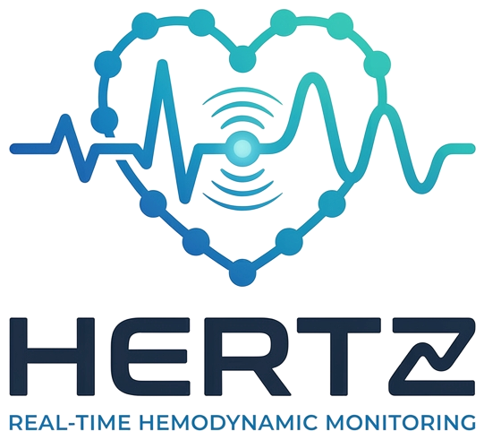

<p align="center"></p>

# HERTS / HERTZ — Website Dashboard Pemantauan Jantung & Paru (EIT + ECG)

Antarmuka web untuk sistem pemantauan jantung dan paru berbasis **Electrical Impedance Tomography (EIT)** dengan tambahan **ECG**, dikembangkan sebagai bagian dari capstone Teknik Biomedis (UGM). Website memiliki dua portal: **pasien** dan **dokter**.

> **Status: prototipe frontend, sebagian sudah terhubung ke Supabase.** Tiga halaman portal dokter (`doctor-signin.html`, `doctor-overview.html`, `doctor-session-detail.html`) membaca data dari Supabase. Halaman lainnya, termasuk seluruh portal pasien, masih memakai **data dummy fiktif**. Citra EIT dan gelombang ECG masih **ilustrasi**, bukan hasil pengukuran perangkat.
>
> **Catatan penamaan:** logo baru bertuliskan **HERTZ** ("Real-Time Hemodynamic Monitoring"), sedangkan teks UI, `<title>`, dan komentar kode memakai **HERTS** ("High-speed Electrical Reconstruction Tomography System"). Keduanya belum diseragamkan.

## Teknologi

| Lapisan | Yang dipakai |
|---|---|
| Markup | HTML5 statis (14 halaman) |
| Gaya | CSS biasa (3 file) dengan design token, tanpa preprocessor |
| Logika | JavaScript vanilla (ES5-style, tanpa modul/bundler), 3 file eksternal + skrip inline per halaman |
| Visualisasi | `<canvas>` 2D (citra EIT ilustratif) dan SVG yang dibangun lewat JS (strip ECG) di `doctor-session-detail.html`; sisi pasien memakai gambar statis (`eit-circle.png`, `eit-recorded.png`, `ecg-strip.png`) |
| Font | IBM Plex Sans via Google Fonts |
| Backend (sebagian) | Supabase (Auth + Postgres) lewat `@supabase/supabase-js` dari CDN jsDelivr; dipakai di 3 halaman dokter |
| Build / package manager | **Tidak ada** (tidak ada `package.json`, framework, atau langkah build) |

## Struktur folder

```
.
├── index.html                      Beranda / landing page
├── information.html                Information & Guide
├── login.html                      Pemilihan peran (pasien / dokter)
│
├── patient-signin.html             Sign in pasien
├── patient-monitoring.html         Monitoring pasien
├── patient-history.html            Riwayat sesi pasien
├── patient-session-detail.html     Detail sesi (?session=SES-001)
├── patient-profile.html            Profil pasien
│
├── doctor-signin.html              Sign in dokter
├── doctor-overview.html            Overview dokter
├── doctor-patients.html            Daftar pasien
├── doctor-patient-detail.html      Detail pasien (?patient=P001)
├── doctor-session-detail.html      Detail sesi (?session=SES-018), canvas EIT + ECG
├── doctor-profile.html             Profil dokter
│
└── assets/
    ├── patient-portal.css          Sistem visual utama (dipakai portal pasien DAN dokter)
    ├── doctor-portal.css           Tambahan gaya portal dokter
    ├── signin.css                  Gaya halaman sign in
    ├── sessions.js                 Data dummy sesi pasien (HERTS_SESSIONS)
    ├── doctor.js                   Data dummy dokter/pasien/sesi + shell header/footer portal dokter
    ├── signin.js                   Validasi form sign in + navigasi prototipe
    ├── supabase-config.js          URL proyek Supabase + publishable key (publik)
    ├── supabase-client.js          Membuat window.HERTS_SUPABASE
    ├── herts-logo.png              Lambang logo (warna, latar transparan)
    ├── herts-logo-white.png        Lambang logo putih untuk header berlatar biru
    ├── hertz-logo-full.png         Logo lengkap (dipakai README)
    └── *.png / *.jpg               Logo, ikon, ilustrasi, gambar EIT/ECG
```

Semua tautan antarhalaman dan referensi aset memakai **path relatif**, dengan semua halaman HTML berada di root. Karena itu folder bisa dipindah atau dibuka di mana saja tanpa konfigurasi.

## Alur halaman

- `index.html` → `information.html` / `login.html`
- `login.html` → `patient-signin.html` atau `doctor-signin.html`
- Sign in pasien → `patient-monitoring.html` ⇄ `patient-history.html` → `patient-session-detail.html?session=…`; `patient-profile.html` dari header
- Sign in dokter (Supabase Auth) → `doctor-overview.html` ⇄ `doctor-patients.html` → `doctor-patient-detail.html?patient=…` → `doctor-session-detail.html?session=…`; `doctor-profile.html` dari header (di-render lewat `assets/doctor.js`)

## Sistem visual

Palet diambil dari logo HERTZ dan didefinisikan sebagai variabel CSS (`:root`), bukan nilai tersebar. Arahnya: **navy** (header, judul, panel data gelap), **biru primer** (tombol, tautan, state aktif), **sky/teal** (aksen data, sewarna jejak ECG), dengan latar putih keabu-abuan. **Merah hanya dipakai untuk alert dan error** (`--alert`), bukan sebagai warna merek.

| Token | Nilai | Dipakai untuk |
|---|---|---|
| `--brand` / `--brand-deep` | `#2F5EA7` / `#234A86` | Tombol, tautan, state aktif / hover |
| `--blue-2` | `#3977B4` | Ujung gradien header, aksen dekoratif (**bukan untuk teks**, kontras 4,4:1) |
| `--ink` / `--head` | `#17212F` | Teks utama dan judul (navy) |
| `--ink-2` / `--muted` | `#385768` / `#4F6575` | Teks sekunder |
| `--bg` / `--surface` | `#F7F8F8` / `#FFFFFF` | Latar halaman / kartu |
| `--signal` / `--teal` | `#6BBBCE` / `#5DBCBC` | Aksen data pada panel gelap (teal hanya dekoratif) |
| `--control` | `#6F8399` | Batas input dan kontrol (kontras ≥ 3:1) |
| `--alert` | `#B42318` | Alert dan error (sama dengan warna error di `doctor-signin.html`) |
| `--header-bg` | gradien `#17212F` → `#3977B4` | Header semua halaman |

Header berlatar biru memakai `herts-logo-white.png` (siluet putih); latar terang memakai `herts-logo.png` (berwarna). Halaman login memakai duotone biru (`mix-blend-mode: color`) pada foto paru-paru.

Token didefinisikan di **lima tempat** (belum disatukan agar struktur file tidak berubah): `assets/patient-portal.css` (juga dipakai portal dokter), `assets/signin.css`, dan blok `<style>` di `index.html`, `information.html`, `login.html`. Kalau mengganti palet, ubah kelimanya. Warna canvas EIT dan jejak ECG di `doctor-session-detail.html` berada di skripnya sendiri. Colormap EIT (viridis) dan legenda skalanya sengaja tidak diubah, begitu pula titik elektroda merah (penanda data).

`assets/dashboard-preview.png` (pratinjau di hero beranda) adalah tangkapan layar halaman monitoring pasien. Gambar ini perlu dibuat ulang setiap kali tampilan halaman itu berubah.

## Menjalankan secara lokal

Website ini statis, jadi tidak ada instalasi dan tidak ada build.

**Cara cepat:** buka `index.html` langsung di browser (double-click).

**Disarankan:** jalankan server statis lokal dari folder ini, agar perilakunya mendekati hosting sungguhan:

```bash
# Python 3
python3 -m http.server 8000
# lalu buka http://localhost:8000
```

atau `npx serve .` (butuh Node.js) atau ekstensi *Live Server* di VS Code.

### Koneksi internet

Dua dependensi eksternal: **Google Fonts** (IBM Plex Sans, lewat `fonts.googleapis.com` dan `fonts.gstatic.com`) dan **jsDelivr** (`@supabase/supabase-js`, dimuat di tiga halaman dokter). Tanpa internet, halaman statis tetap tampil dengan font sistem, tetapi **halaman dokter yang terhubung Supabase tidak bisa memuat data atau melakukan sign in**.

## Data & kredensial

- **Tidak ada kunci rahasia** di repository (diperiksa: tidak ada `service_role`, `sb_secret_…`, JWT, atau connection string). `assets/supabase-config.js` berisi URL proyek dan **publishable key**, yang memang publik dan aman berada di frontend.
- **Keamanan data bertumpu pada Row Level Security (RLS) di Supabase**, bukan pada kode frontend. Tabel `patients` memuat nama dan tanggal lahir. Pastikan RLS aktif di `patients`, `sessions`, dan `measurements` dengan policy yang membatasi akses ke dokter yang berwenang. Tanpa itu, siapa pun yang membuka situs bisa membaca datanya.
- Jangan pernah menaruh `service_role` / secret key di kode frontend atau di repository. `.gitignore` sudah mengecualikan `.env*` (kecuali `.env.example`).
- Kolom yang dibaca kode saat ini (disimpulkan dari pemanggilan `.select()`, bukan dari skema database): `patients(id, patient_code, full_name, date_of_birth, sex, created_at)`, `sessions(id, session_code, patient_id, started_at, duration_minutes, status, recording_available, created_at)`, dan `measurements(session_id)` hanya untuk menghitung jumlah baris.
- Data dummy yang masih dipakai: `assets/sessions.js` (`HERTS_SESSIONS`, portal pasien) dan `assets/doctor.js` (`HD_DOCTOR`, `HD_PATIENTS`, `HD_SESSIONS`, `HD_TODAY`; dipakai `doctor-patients`, `doctor-patient-detail`, `doctor-profile`, dan header portal dokter). Nama "Budi Artanto" di header portal pasien ditulis langsung di HTML.

## Status koneksi Supabase

| Halaman | Status |
|---|---|
| `doctor-signin.html` | Terhubung: `auth.signInWithPassword` |
| `doctor-overview.html` | Terhubung: membaca `patients` dan `sessions` |
| `doctor-session-detail.html` | Terhubung: membaca `sessions`, `patients`, dan jumlah `measurements` |
| `doctor-patients.html`, `doctor-patient-detail.html`, `doctor-profile.html` | Masih data dummy (`assets/doctor.js`) |
| Seluruh portal pasien (`patient-*.html`) | Masih data dummy; `assets/signin.js` hanya validasi form, **tanpa autentikasi** |

Halaman detail membaca parameter lewat query string: `?session=<id sesi>` (di halaman yang terhubung, ini `sessions.id` dari Supabase) dan `?patient=` (halaman dummy).

## Masalah yang diketahui / belum diselesaikan

1. **Header portal dokter menampilkan nama dummy.** Header dan footer di `doctor-overview.html` dan `doctor-session-detail.html` sudah dipulihkan (pemanggilan `HD.shell(...)` sempat hilang saat halaman dihubungkan ke Supabase). Namun header itu masih membaca `HD_DOCTOR.name` dari `assets/doctor.js` ("Dr. Sari Wulandari"), bukan dokter yang sedang login.
2. **Tidak ada guard autentikasi.** Halaman dokter dapat dibuka langsung lewat URL tanpa sign in; keamanan data hanya ditentukan oleh RLS (lihat di atas). Portal pasien belum memakai autentikasi sama sekali.
3. **supabase-js dimuat dengan versi mengambang** (`@supabase/supabase-js@2` dari jsDelivr). Sebaiknya dipatok ke versi persis.
4. **Tautan "Create Account" rusak (disengaja sebagai placeholder):** `patient-signin.html` → `patient-register.html` dan `doctor-signin.html` → `doctor-register.html`. Kedua halaman belum ada.
5. **Email kontak placeholder:** `XXXXXXX@gmail.com` di footer semua halaman (juga di template footer `assets/doctor.js`) perlu diganti email nyata.
6. **`assets/eit-frame.png` tidak dirujuk** oleh HTML, CSS, maupun JS mana pun. File dipertahankan karena belum dipastikan tidak terpakai.
7. **Teks tidak konsisten:** `patient-signin.html` menyebut "8-electrode cardiac sensing system", dan halaman EIT kini konsisten memakai 8 elektroda (E1–E8) (sebelumnya doctor-session-detail.html menampilkan 16). Selain itu, logo bertuliskan HERTZ sementara teks UI memakai HERTS.
8. **Gambar EIT sisi pasien berlatar putih opak** (`eit-circle.png`, `eit-recorded.png`), sehingga panelnya tetap putih, sementara panel EIT dokter (canvas) gelap. Agar seragam, ekspor ulang gambar dengan latar transparan atau pakai renderer canvas yang sama.
9. **Akhir baris campuran:** file Supabase memakai CRLF, file lain LF. Tidak berdampak pada fungsi, tetapi bisa memunculkan diff yang berisik di Git.
10. **Pengujian terbatas.** Sudah: semua referensi lokal, sintaks semua JS, dan render halaman kunci di Chromium headless (1280 px dan 390 px) tanpa error JavaScript. Halaman yang terhubung Supabase diuji dengan **stub supabase-js berisi data contoh**, bukan database sungguhan. Belum: koneksi Supabase nyata, interaksi (filter, sort, tombol), browser lain, dan perangkat sungguhan.


## Panel EIT bersama (assets/eit-panel.css + assets/eit-panel.js)
Dipakai oleh patient-monitoring.html, patient-session-detail.html, doctor-session-detail.html.
Layout: EIT kiri, satu grafik U di kanan (grafik ΔU dihapus). 8 elektroda, urutan E1→E2 … E8→E1, 5 pengukuran per injeksi (40 titik).
Grafik memakai DATA PLACEHOLDER ilustratif (berlabel di layar) sampai `window.HERTS_EIT_DATA = {baseline:[40], live:[40]}` diisi
sebelum eit-panel.js dimuat. Label sumbu Y ("Estimated |Z| (Ω)") mengikuti aplikasi desktop — konfirmasi dengan kode akuisisi.
